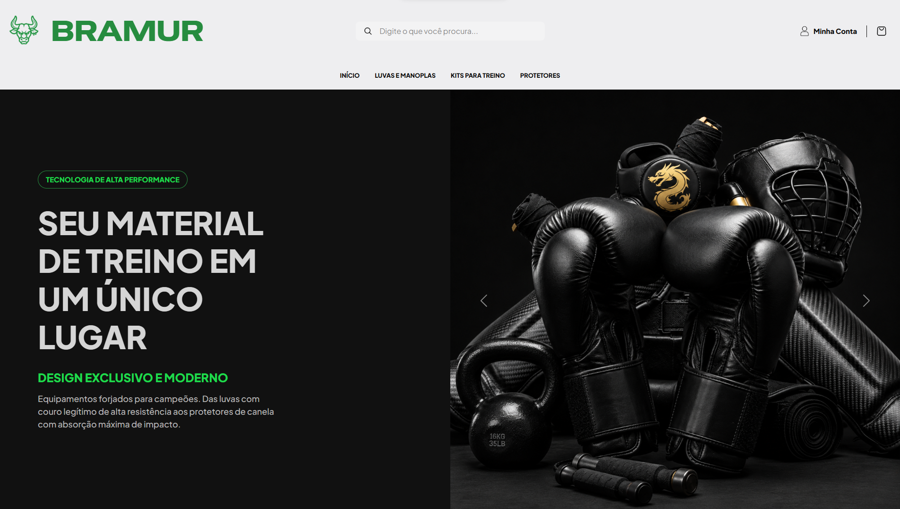
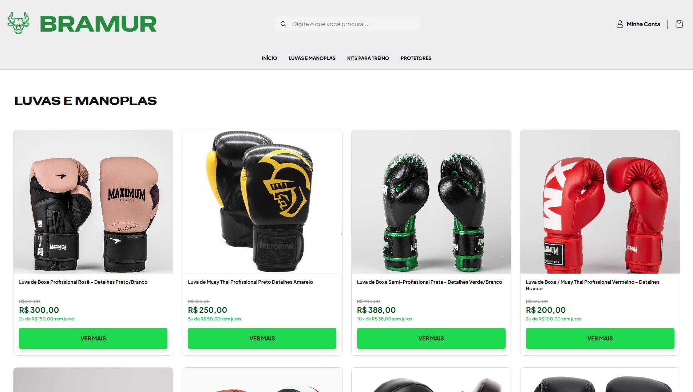
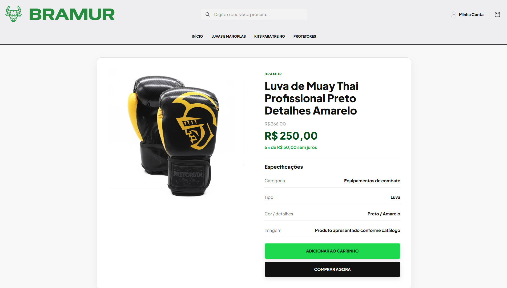
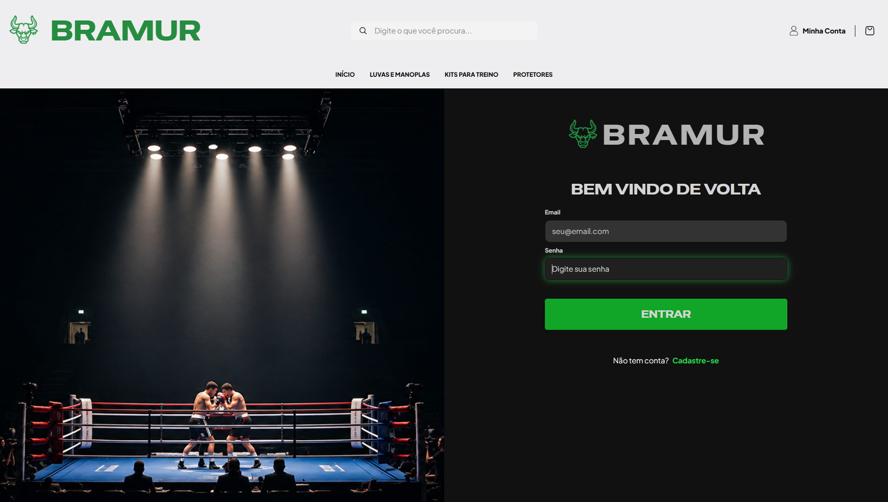

<!-- Substitua pelo caminho do seu logotipo real, se houver -->

# Bramur

### E-commerce de artigos de luta

**Equipamentos para quem luta por seus objetivos.**

Uma loja virtual desenvolvida como projeto acadêmico, voltada para o universo do boxe, Muay Thai e esportes de combate.

[Repositório](https://github.com/victtor1910/Bramur-ecommerce) · [Tecnologias](#-tecnologias) · [Capturas de tela](#-screenshots)

 

---

## 📖 Sobre o projeto

A Bramur é um projeto acadêmico de desenvolvimento web que busca apresentar uma experiência de loja virtual para artigos de esportes de combate.

## 🛠️ Tecnologias

- HTML5
- CSS3
- JavaScript
- Bootstrap, se utilizado no projeto

## 🖼️ Capturas de tela

Adicione aqui as imagens reais das páginas do site.

## 🚀 Como executar

1. Baixe ou clone este repositório.
2. Abra a pasta do projeto.
3. Execute o arquivo `index.html` no navegador.

---

**Desenvolvido com dedicação e aprendizado. 🥊**

###  Objetivos

- Criar uma experiência de navegação intuitiva.
- Organizar páginas e recursos de uma loja virtual.
- Aplicar conceitos de HTML, CSS e JavaScript.
- Desenvolver uma interface visual consistente.
- Praticar a organização e a documentação de um projeto no GitHub.

##  Funcionalidades
- 🏠 Página inicial.
- 🥊 Catálogo de produtos.
- 👤 Páginas de login e cadastro.
- 🧭 Navegação entre páginas.
- 📱 Layout responsivo.

## 🛠️ Tecnologias

| Tecnologia | Finalidade |
|---|---|
| HTML | Estrutura das páginas |
| CSS | Estilização e layout |
| JavaScript | Interatividade |
| Bootstrap | Componentes e recursos de interface. |

# 🥊 Bramur — Preview do projeto

### Página inicial

### Catálogo de produtos

### Detalhes do produto

### Login

## 📚 Aprendizados

Durante o desenvolvimento, o projeto permite praticar:

- Estruturação de páginas com HTML.
- Estilização e organização visual com CSS.
- Uso de componentes do Bootstrap, quando aplicável.
- Manipulação do DOM e eventos com JavaScript.
- Organização de arquivos e versionamento com Git e GitHub.
- Documentação e apresentação de projetos.

## 🔭 Próximas melhorias

Possíveis evoluções futuras, conforme os objetivos do projeto:

- Melhorar a experiência em dispositivos móveis.
- Aprimorar a acessibilidade e a navegação.
- Implementar filtros e busca de produtos.
- Integrar um backend e um banco de dados.

## 🎓 Contexto acadêmico

Projeto desenvolvido para fins educacionais, com o objetivo de aplicar conhecimentos de programação e desenvolvimento web.

## 👨‍💻 Autor

**Vícttor** — estudante de tecnologia e desenvolvimento web.

- GitHub: [@Vícttor Eduardo](https://github.com/victtor1910)

---

  Desenvolvido com dedicação, aprendizado e tecnologia. 🥊

